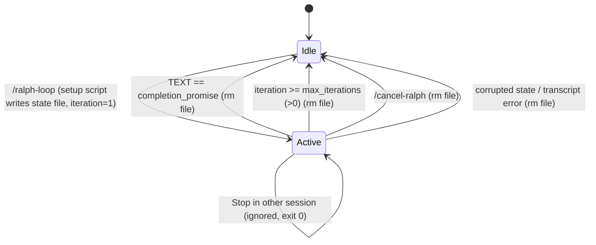
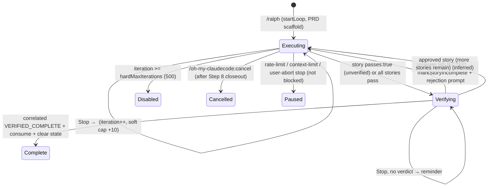
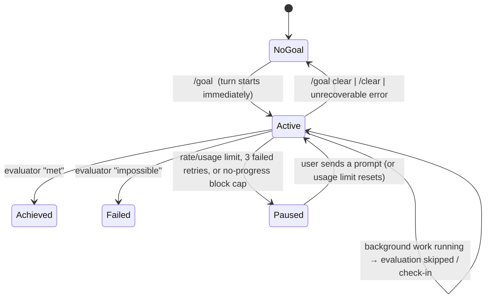

# Claude Code plugin ecosystem: "goal"-style persistent autonomous tasks (ralph-loop, oh-my-claudecode, built-in /goal, others), as of 2026-11-18

Method note: the sandbox `/tmp` volume was full (tmpfs at 100%), so no `git clone` was possible. All source below was fetched read-only from `raw.githubusercontent.com` / GitHub API on 2026-11-18 (`main` branches) and read, not executed. Line numbers are from those fetches. Repos covered:
- `anthropics/claude-plugins-official` → `plugins/ralph-loop` (plugin.json `"version": "1.0.1"`; last commit 2026-10-26 `30202c7`).
- `anthropics/claude-code` → `plugins/` now contains only `README.md`; the old `plugins/ralph-wiggum` was removed in commit `10a5141` (2026-10-26, "Install marketplace plugins from claude-plugins-official").
- `Yeachan-Heo/oh-my-claudecode` (OMC), ~40.9k stars, latest release `v5.8.4` (2026-11-10), main pushed 2026-11-18.
- Claude Code built-in `/goal` (closed source; docs only).
- `frankbria/ralph-claude-code` (~9.7k stars), an external bash-loop harness.

---

## Q1. Which files implement each project (paths + line ranges) and key code excerpts

### Takeaway
The official ralph-loop is about 5 small files: one slash command that runs a bash setup script, which writes a markdown state file, plus one bash Stop hook that re-feeds the prompt using `{"decision":"block","reason":<prompt>}`. OMC's ralph is a large TypeScript system: a skill prompt, a session-scoped JSON state, a PRD (`prd.json`), a verifier module, and a ~2.7k-line `persistent-mode` Stop-hook dispatcher that ranks several modes by priority (ralph, autopilot, ultragoal, team, …). The built-in `/goal` is documented as "a wrapper around a session-scoped prompt-based Stop hook" with a small-fast-model evaluator.

### Cited Findings

**A. Official `ralph-loop` plugin (formerly `ralph-wiggum`)**
- History: the plugin was added as `ralph-wiggum` in `anthropics/claude-code` on 2025-11-16 (commit `68f90e0` "feat: Add ralph-wiggum plugin for iterative self-referential development"). It was renamed `ralph-loop` in claude-plugins-official on 2026-01-06 (`44328be` "Rename ralph-wiggum plugin to ralph-loop per legal guidance (#142)"). The copy in claude-code was removed 2026-10-26 (`10a5141`) — [claude-code commits](https://github.com/anthropics/claude-code/commits/main/plugins/ralph-wiggum); [claude-plugins-official commits](https://github.com/anthropics/claude-plugins-official/commits/main/plugins/ralph-loop)
- Later fixes in claude-plugins-official: `adfc379` (2026-03-02) "stop hook fails when last assistant block is tool_use"; `8644df9` (2026-03-02) "isolate loop state to the session that started it"; `028eccf` (2026-03-04) "bound grep to tail -n 100; restore explicit error paths"; `986deab` (2026-03-28) "invoke .sh hooks via bash prefix; add version for cache invalidation"; `30202c7` (2026-10-26) "Give ten plugins explicit versions" — [commits](https://github.com/anthropics/claude-plugins-official/commits/main/plugins/ralph-loop)
- Files:
  - `.claude-plugin/plugin.json`: name `ralph-loop`, version `1.0.1`, description "Continuous self-referential AI loops for interactive iterative development, implementing the Ralph Wiggum technique. Run Claude in a while-true loop with the same prompt until task completion." — [plugin.json](https://github.com/anthropics/claude-plugins-official/blob/main/plugins/ralph-loop/.claude-plugin/plugin.json)
  - `hooks/hooks.json` (L1-15) registers a single Stop hook: `"command": "bash \"${CLAUDE_PLUGIN_ROOT}/hooks/stop-hook.sh\""` — [hooks.json](https://github.com/anthropics/claude-plugins-official/blob/main/plugins/ralph-loop/hooks/hooks.json)
  - `commands/ralph-loop.md` (L1-18): the start command — [ralph-loop.md](https://github.com/anthropics/claude-plugins-official/blob/main/plugins/ralph-loop/commands/ralph-loop.md)
  - `commands/cancel-ralph.md` (L1-18): the cancel command — [cancel-ralph.md](https://github.com/anthropics/claude-plugins-official/blob/main/plugins/ralph-loop/commands/cancel-ralph.md)
  - `commands/help.md` (L1-126): help text — [help.md](https://github.com/anthropics/claude-plugins-official/blob/main/plugins/ralph-loop/commands/help.md)
  - `scripts/setup-ralph-loop.sh` (L1-204): argument parsing and state-file creation — [setup-ralph-loop.sh](https://github.com/anthropics/claude-plugins-official/blob/main/plugins/ralph-loop/scripts/setup-ralph-loop.sh)
  - `hooks/stop-hook.sh` (L1-191): the loop engine — [stop-hook.sh](https://github.com/anthropics/claude-plugins-official/blob/main/plugins/ralph-loop/hooks/stop-hook.sh)
- `commands/ralph-loop.md` frontmatter, verbatim:
  ```
  ---
  description: "Start Ralph Loop in current session"
  argument-hint: "PROMPT [--max-iterations N] [--completion-promise TEXT]"
  allowed-tools: ["Bash(${CLAUDE_PLUGIN_ROOT}/scripts/setup-ralph-loop.sh:*)"]
  hide-from-slash-command-tool: "true"
  ---
  ```
  The body runs the script with a `` ```! `` bash-execution block: `"${CLAUDE_PLUGIN_ROOT}/scripts/setup-ralph-loop.sh" $ARGUMENTS` — [ralph-loop.md](https://github.com/anthropics/claude-plugins-official/blob/main/plugins/ralph-loop/commands/ralph-loop.md)
- Key stop-hook lines, verbatim (stop-hook.sh). Activation (L13-18): `RALPH_STATE_FILE=".claude/ralph-loop.local.md"` / `if [[ ! -f "$RALPH_STATE_FILE" ]]; then` / `  # No active loop - allow exit` / `  exit 0`. Frontmatter parsing (L21-25): `FRONTMATTER=$(sed -n '/^---$/,/^---$/{ /^---$/d; p; }' "$RALPH_STATE_FILE")`. Final output (L181-188):
  ```bash
  jq -n \
    --arg prompt "$PROMPT_TEXT" \
    --arg msg "$SYSTEM_MSG" \
    '{
      "decision": "block",
      "reason": $prompt,
      "systemMessage": $msg
    }'
  ```
  — [stop-hook.sh](https://github.com/anthropics/claude-plugins-official/blob/main/plugins/ralph-loop/hooks/stop-hook.sh)
- Last-assistant-text extraction (L98, L112-114): `LAST_LINES=$(grep '"role":"assistant"' "$TRANSCRIPT_PATH" | tail -n 100)` then `jq -rs 'map(.message.content[]? | select(.type == "text") | .text) | last // ""'`. The comment notes "Claude Code writes each content block (text/tool_use/thinking) as its own JSONL line, all with role=assistant" — [stop-hook.sh](https://github.com/anthropics/claude-plugins-official/blob/main/plugins/ralph-loop/hooks/stop-hook.sh)

**B. oh-my-claudecode (OMC) — ralph / ultragoal / autopilot / persistent-mode**
- `hooks/hooks.json` registers five Stop hooks, each run as `node ${CLAUDE_PLUGIN_ROOT}/scripts/run.cjs <script>`: `context-guard-stop.mjs` (timeout 5), `workflow-drift-guard.mjs` (3), `persistent-mode.mjs` (20), `budget-guard.mjs` (5), `code-simplifier.mjs` (10). UserPromptSubmit runs `keyword-detector.mjs` and `skill-injector.mjs` (timeout 30 each) — [hooks.json](https://github.com/Yeachan-Heo/oh-my-claudecode/blob/main/hooks/hooks.json)
- `scripts/persistent-mode.mjs` (~100 KB) header: "OMC Persistent Mode Hook (Node.js) / Minimal continuation enforcer for all OMC modes. … Supported modes: ralph, ultragoal, autopilot, ultrapilot, swarm, pipeline, team". `adaptBridgeOutput` (L1570-1602) converts the TS bridge's `{continue, message}` into the Stop protocol: `return { decision: "block", reason: parsed.message };` (allow-stop is `{ continue: true, suppressOutput: true }`, L34 `SAFE_CONTINUE`) — [persistent-mode.mjs](https://github.com/Yeachan-Heo/oh-my-claudecode/blob/main/scripts/persistent-mode.mjs)
- `src/hooks/persistent-mode/index.ts` (~99 KB): header "Unified handler for persistent work modes: ralph and todo-continuation … 1. Active ralph loop (until cancelled via /oh-my-claudecode:cancel) 2. Any pending todos … Priority order: Ralph > Todo Continuation" (L1-10). `checkRalphLoop` starts at L1271; `resolvePersistentModeBlock` (priority dispatcher) at ~L2444; later priorities are "Priority 1.6: Autoresearch", "1.7: Ralplan", "1.8: Team Pipeline", "2: Skill Active State" (L2692-2722) — [persistent-mode/index.ts](https://github.com/Yeachan-Heo/oh-my-claudecode/blob/main/src/hooks/persistent-mode/index.ts)
- `src/hooks/ralph/loop.ts`: `RalphLoopState` interface (L47-68) with fields `active, iteration, max_iterations, started_at, prompt, session_id?, project_path?, prd_mode?, current_story_id?, critic_mode?`; `RALPH_CRITIC_MODES = ['architect', 'critic', 'codex']` (L70); `const DEFAULT_MAX_ITERATIONS = 10;` and `DEFAULT_RALPH_CRITIC_MODE = 'architect'` (L105-106); `startLoop` (L244-307) ensures a PRD (`ensurePrdForStartup`), reconciles stale PRDs, prints the feedback-gate notice, then writes state with `iteration: 1`, `prd_mode: true` — [loop.ts](https://github.com/Yeachan-Heo/oh-my-claudecode/blob/main/src/hooks/ralph/loop.ts)
- `src/hooks/ralph/verifier.ts`: `DEFAULT_MAX_VERIFICATION_ATTEMPTS = 3` (L53); `getArchitectVerificationPrompt` (L276-335); `getArchitectRejectionContinuationPrompt` (L339-365); `detectArchitectApproval` regex (L388); `REJECTION_PATTERNS` (L424-431) — [verifier.ts](https://github.com/Yeachan-Heo/oh-my-claudecode/blob/main/src/hooks/ralph/verifier.ts)
- Other ralph modules: `prd.ts` (45 KB), `stale-prd.ts`, `progress.ts`, `feedback-baseline.ts`, `closeout.ts`, `jev-shadow.ts` in `src/hooks/ralph/`; CLI `src/cli/commands/ralph.ts` — [repo tree](https://github.com/Yeachan-Heo/oh-my-claudecode/tree/main/src/hooks/ralph)
- `src/lib/security-config.ts` (L38-56): `hardMaxIterations: 500` by default, `200` under strict overrides — [security-config.ts](https://github.com/Yeachan-Heo/oh-my-claudecode/blob/main/src/lib/security-config.ts)
- `skills/ralph/SKILL.md` frontmatter: `name: ralph`, `description: Self-referential loop until task completion with configurable verification reviewer`, `argument-hint: "[--no-deslop] [--critic=architect|critic|codex] <task description>"`, `level: 4` — [ralph SKILL.md](https://github.com/Yeachan-Heo/oh-my-claudecode/blob/main/skills/ralph/SKILL.md)
- `skills/ultragoal/SKILL.md` + `src/cli/commands/ultragoal.ts` + `src/ultragoal/artifacts.ts` + `src/goal-workflows/claude-goal-snapshot.ts` + `docs/design/CLAUDE_CODE_GOAL_ADAPTER.md`: OMC's layer on top of the native Claude Code `/goal` — [ultragoal SKILL.md](https://github.com/Yeachan-Heo/oh-my-claudecode/blob/main/skills/ultragoal/SKILL.md); [goal adapter design](https://github.com/Yeachan-Heo/oh-my-claudecode/blob/main/docs/design/CLAUDE_CODE_GOAL_ADAPTER.md)
- Autopilot lives in `src/hooks/autopilot/` (`enforcement.ts`, `prompts.ts`, `state.ts`, `pipeline.ts`, adapters including `ralph-adapter.ts`); `persistent-mode.mjs` L486-488 returns `{ continue: false, decision: "block", reason: "[AUTOPILOT WORKFLOW] All selected stages are complete." }` when no stage remains — [persistent-mode.mjs](https://github.com/Yeachan-Heo/oh-my-claudecode/blob/main/scripts/persistent-mode.mjs). (These notes do not cover autopilot or ultrawork internals in depth.)

**C. Claude Code built-in `/goal` (closed source — docs only)**
- "`/goal` is a wrapper around a session-scoped prompt-based Stop hook. Each time Claude finishes a turn, Claude Code sends the condition and the conversation so far to your configured small fast model." — [Claude Code docs: goal](https://code.claude.com/docs/en/goal)
- No source code is available. The implementation-level facts below come from the docs page and public GitHub issues only — [docs](https://code.claude.com/docs/en/goal)

**D. frankbria/ralph-claude-code (external harness, not a Stop-hook plugin)**
- `ralph_loop.sh` (3,673 lines) runs Claude Code repeatedly from bash. `lib/` holds `circuit_breaker.sh`, `response_analyzer.sh`, `ralphrc.sh` and others. Exit logic is in `should_exit_gracefully()` (L1001-~1110) — [ralph_loop.sh](https://github.com/frankbria/ralph-claude-code/blob/main/ralph_loop.sh)

### Inferences
- The official plugin is simple on purpose: a reference implementation of the "Stop hook + state file" pattern. OMC grew that same pattern into a multi-mode workflow engine with PRD tracking, a reviewer gate, locks, and session ledgers.
- Since 2026-10-26, the Anthropic-maintained ralph is found only in claude-plugins-official. Many open PRs/issues against `anthropics/claude-code` `plugins/ralph-wiggum` (see Q5) are now likely stale.

### Gaps
- I did not read OMC `prd.ts`, `autopilot/*`, `ultrawork`, or `keyword-detector.mjs` line by line, because of size and the tool budget. Exactly how `/ralph` or the "ralph" keyword creates `ralph-state.json` (skill vs keyword detector) is not quoted here.
- Commit SHAs for OMC files were not pinned (fetched from `main` on 2026-11-18).

---

## Q2. Exact prompts / system messages at start, each continuation, and completion (verbatim)

### Takeaway
Official ralph-loop re-injects the user's original prompt unchanged as the Stop-hook `reason`, plus a one-line `systemMessage` with the iteration counter. Anti-cheating text ("do not lie to exit") appears at start and in every systemMessage. OMC injects a structured `<ralph-continuation>` block with iteration X/Y, PRD instructions and the original task. When all stories pass, it switches to a `<ralph-verification>` block that asks for a correlated `<ralph-approved …>VERIFIED_COMPLETE</ralph-approved>` tag from a reviewer subagent. The built-in `/goal` starts with the condition itself as the directive and feeds the evaluator's reason back as guidance. Its exact internal prompt text is not public.

### Cited Findings

**Official ralph-loop: start (command body + setup-script stdout)**
- Command body, verbatim (ralph-loop.md L16-18):
  > Please work on the task. When you try to exit, the Ralph loop will feed the SAME PROMPT back to you for the next iteration. You'll see your previous work in files and git history, allowing you to iterate and improve.
  >
  > CRITICAL RULE: If a completion promise is set, you may ONLY output it when the statement is completely and unequivocally TRUE. Do not output false promises to escape the loop, even if you think you're stuck or should exit for other reasons. The loop is designed to continue until genuine completion.

  — [ralph-loop.md](https://github.com/anthropics/claude-plugins-official/blob/main/plugins/ralph-loop/commands/ralph-loop.md)
- Setup-script stdout (part of the start context), verbatim (setup-ralph-loop.sh L154-171):
  ```
  🔄 Ralph loop activated in this session!

  Iteration: 1
  Max iterations: $(if [[ $MAX_ITERATIONS -gt 0 ]]; then echo $MAX_ITERATIONS; else echo "unlimited"; fi)
  Completion promise: $(if [[ "$COMPLETION_PROMISE" != "null" ]]; then echo "${COMPLETION_PROMISE//\"/} (ONLY output when TRUE - do not lie!)"; else echo "none (runs forever)"; fi)

  The stop hook is now active. When you try to exit, the SAME PROMPT will be
  fed back to you. You'll see your previous work in files, creating a
  self-referential loop where you iteratively improve on the same task.

  To monitor: head -10 .claude/ralph-loop.local.md

  ⚠️  WARNING: This loop cannot be stopped manually! It will run infinitely
      unless you set --max-iterations or --completion-promise.

  🔄
  ```
  The script then echoes `$PROMPT`. If a promise is set it also prints (L182-203):
  ```
  ═══════════════════════════════════════════════════════════
  CRITICAL - Ralph Loop Completion Promise
  ═══════════════════════════════════════════════════════════

  To complete this loop, output this EXACT text:
    <promise>$COMPLETION_PROMISE</promise>

  STRICT REQUIREMENTS (DO NOT VIOLATE):
    ✓ Use <promise> XML tags EXACTLY as shown above
    ✓ The statement MUST be completely and unequivocally TRUE
    ✓ Do NOT output false statements to exit the loop
    ✓ Do NOT lie even if you think you should exit

  IMPORTANT - Do not circumvent the loop:
    Even if you believe you're stuck, the task is impossible,
    or you've been running too long - you MUST NOT output a
    false promise statement. The loop is designed to continue
    until the promise is GENUINELY TRUE. Trust the process.

    If the loop should stop, the promise statement will become
    true naturally. Do not force it by lying.
  ═══════════════════════════════════════════════════════════
  ```
  — [setup-ralph-loop.sh](https://github.com/anthropics/claude-plugins-official/blob/main/plugins/ralph-loop/scripts/setup-ralph-loop.sh)

**Official ralph-loop: each continuation**
- `reason` = `PROMPT_TEXT`, the body of the state file after the second `---`, read with `awk '/^---$/{i++; next} i>=2'` (L150). It is the user's original prompt, unchanged — [stop-hook.sh](https://github.com/anthropics/claude-plugins-official/blob/main/plugins/ralph-loop/hooks/stop-hook.sh)
- `systemMessage`, verbatim (L173-177):
  ```bash
  SYSTEM_MSG="🔄 Ralph iteration $NEXT_ITERATION | To stop: output <promise>$COMPLETION_PROMISE</promise> (ONLY when statement is TRUE - do not lie to exit!)"
  ...
  SYSTEM_MSG="🔄 Ralph iteration $NEXT_ITERATION | No completion promise set - loop runs infinitely"
  ```
  — [stop-hook.sh](https://github.com/anthropics/claude-plugins-official/blob/main/plugins/ralph-loop/hooks/stop-hook.sh)

**Official ralph-loop: completion / termination messages (stdout/stderr, exit 0)**
- `✅ Ralph loop: Detected <promise>$COMPLETION_PROMISE</promise>` (L138); `🛑 Ralph loop: Max iterations ($MAX_ITERATIONS) reached.` (L62). Error paths print `⚠️  Ralph loop: State file corrupted` / `Transcript file not found` / `No assistant messages found in transcript` / `Failed to parse assistant message JSON`, each followed by `Ralph loop is stopping.` and `rm "$RALPH_STATE_FILE"` — [stop-hook.sh](https://github.com/anthropics/claude-plugins-official/blob/main/plugins/ralph-loop/hooks/stop-hook.sh)
- Cancel reply: "Cancelled Ralph loop (was at iteration N)" or "No active Ralph loop found." — [cancel-ralph.md](https://github.com/anthropics/claude-plugins-official/blob/main/plugins/ralph-loop/commands/cancel-ralph.md)

**OMC ralph: start**
- The skill body starts with a template header (SKILL.md L8-10):
  ```
  [RALPH - ITERATION {{ITERATION}}/{{MAX}}]

  Your previous attempt did not output the completion promise. Continue working on the task.
  ```
  It continues with `<Purpose>`: "Ralph is a PRD-driven persistence loop that keeps working on a task until ALL user stories in prd.json have passes: true and are reviewer-verified. It combines session persistence, automatic retry on failure, structured story tracking, and mandatory verification before completion." — [ralph SKILL.md](https://github.com/Yeachan-Heo/oh-my-claudecode/blob/main/skills/ralph/SKILL.md)
- Feedback-gate notice printed at `startLoop` (loop.ts L79-85), verbatim start: `` [RALPH FEEDBACK GATE] Before the first story: run `omc ralph verify --write-baseline${session}` to record the feedback baseline. Every later gate (story verification, post-deslop re-verification): run `omc ralph verify${session}` — exit 0 = pass (baseline-only failures are warnings), exit 1 = new failures to fix. Never hand-roll th… `` (the line was truncated in my fetch) — [loop.ts](https://github.com/Yeachan-Heo/oh-my-claudecode/blob/main/src/hooks/ralph/loop.ts)

**OMC ralph: each continuation (persistent-mode/index.ts ~L1666-1690), verbatim template**
```
<ralph-continuation>
${errorGuidance ? errorGuidance + '\n' : ''}
[RALPH - ITERATION ${newState.iteration}/${newState.max_iterations}]

The task is NOT complete yet. Continue working.
${ralphContext}
CRITICAL INSTRUCTIONS:
1. Review your progress and the original task
${prdInstruction}
3. Continue from where you left off
4. When FULLY complete (after ${state.critic_mode === 'codex' ? 'Codex critic' : state.critic_mode === 'critic' ? 'Critic' : 'Architect'} verification), run `/oh-my-claudecode:cancel` to cleanly exit and clean up state files. If cancel fails, report the failure and retry within the same session scope. Cancel all sessions only when the user explicitly requests `--all`.
5. Do NOT stop until the task is truly done

${newState.prompt ? `Original task: ${truncatePromptForEcho(newState.prompt)}` : ''}

</ralph-continuation>

---
```
Here `prdInstruction` is either `` 2. Check ${activePrdPath ?? 'prd.json'} - verify the current story's acceptance criteria are met, then create a revision-bound completion claim: set passes to true and set completionCriteriaRevision to the story's current governingCr… `` (truncated in my fetch) or `2. Check your todo list - are ALL items marked complete?` — [persistent-mode/index.ts](https://github.com/Yeachan-Heo/oh-my-claudecode/blob/main/src/hooks/persistent-mode/index.ts)

**OMC ralph: verification phase (verifier.ts L276-335), verbatim template (abridged only where marked)**
```
<ralph-verification>

[${criticLabel.toUpperCase()} VERIFICATION REQUIRED - Attempt ${state.verification_attempts + 1}/${state.max_verification_attempts}]

The agent claims the task is complete. Before accepting, YOU MUST verify with ${criticLabel}.

**Original Task:**
${state.original_task}

**Completion Claim:**
${state.completion_claim}
…
## MANDATORY VERIFICATION STEPS

${getVerificationAgentStep(state.critic_mode)}

2. **${criticLabel} must check:**
   - Verify EACH acceptance criterion listed above is met with fresh evidence
   - Run the relevant tests/builds to confirm criteria pass
   - Are there any obvious bugs or issues?
   - Does the code compile/run without errors?
   - Are tests passing (if applicable)?
   - Return ONLY a concise review summary under 100 words with verdict, evidence highlights, files checked, and blockers. Do not paste long logs inline.

3. **Based on ${criticLabel}'s response:**
   - If APPROVED: Output the exact correlated approval tag `${approvalTag}`, then run `/oh-my-claudecode:cancel` to cleanly exit
   - If REJECTED: Continue working on the identified issues

</ralph-verification>
```
with `approvalTag = <ralph-approved critic="${getCriticMode(state.critic_mode)}" request-id="${state.request_id}"${state.story_id ? ` story-id="${state.story_id}"` : ''}>VERIFIED_COMPLETE</ralph-approved>`. With a story, it also includes: "IMPORTANT: This review gates Ralph's progression to the next story/complete state. Verify EACH acceptance criterion above is met. Do not verify based on general impressions — check each criterion individually with concrete evidence." — [verifier.ts](https://github.com/Yeachan-Heo/oh-my-claudecode/blob/main/src/hooks/ralph/verifier.ts)

**OMC ralph: after rejection (verifier.ts L339-365), verbatim**
```
<ralph-continuation-after-rejection>

[${criticLabel.toUpperCase()} REJECTED - Continue Working]

${criticLabel} found issues with your completion claim. You must address them.

**${criticLabel} Feedback:**
${state.architect_feedback}

**Original Task:**
${state.original_task}

## INSTRUCTIONS

1. Address ALL issues identified by ${criticLabel}
2. Do NOT claim completion again until issues are fixed${state.story_id ? `, and do not progress story ${state.story_id} until it passes review` : ''}
3. When truly done, another ${criticLabel} verification will be triggered
4. After ${criticLabel} approves, run `/oh-my-claudecode:cancel` to cleanly exit

Continue working now.

</ralph-continuation-after-rejection>
```
— [verifier.ts](https://github.com/Yeachan-Heo/oh-my-claudecode/blob/main/src/hooks/ralph/verifier.ts)

**OMC ralph: completion and terminal messages (persistent-mode/index.ts)**
- `[RALPH LOOP VERIFIED COMPLETE] ${criticLabel} verified task completion after ${state.iteration} iteration(s). Excellent work!` (shouldBlock false)
- `[RALPH VERIFICATION INVALIDATED] The PRD changed while approval was being consumed. Re-run verification against the current criteria.` (shouldBlock true)
- `[RALPH - HARD LIMIT] Reached hard max iterations (${hardMax}). Mode auto-disabled. Restart with /oh-my-claudecode:ralph if needed.`
- `[RALPH PAUSED - RATE LIMITED] API rate limit detected. Ralph loop paused until the rate limit resets. Resume manually once the limit clears.`
- Team-coupled messages: `[RALPH LOOP COMPLETE - TEAM] Team pipeline completed successfully. Ralph loop ending after ${state.iteration} iteration(s).`, `[RALPH LOOP STOPPED - TEAM FAILED] …`, `[RALPH LOOP CANCELLED - TEAM] …`

— [persistent-mode/index.ts](https://github.com/Yeachan-Heo/oh-my-claudecode/blob/main/src/hooks/persistent-mode/index.ts)

**OMC ultragoal continuation (persistent-mode.mjs ~L2034), verbatim**
- `` [ULTRAGOAL #${newCount}/${maxReinforcements}] Ultragoal mode is active. Continue the durable goal workflow, keep the matching Claude /goal active, and checkpoint .omc/ultragoal/ledger.jsonl before stopping. When all ultragoal stories are complete and the final quality gate passes, run /oh-my-claudecode:cancel to cleanly exit. `` with `maxReinforcements = ultragoal.state.max_reinforcements || 50` — [persistent-mode.mjs](https://github.com/Yeachan-Heo/oh-my-claudecode/blob/main/scripts/persistent-mode.mjs)
- OMC's goal-adapter handoff template: `/goal Complete <objective> when <measurable condition>. Before claiming completion, surface evidence from: <proof command>, <docs check>, and <final review checkpoint>.` — [CLAUDE_CODE_GOAL_ADAPTER.md](https://github.com/Yeachan-Heo/oh-my-claudecode/blob/main/docs/design/CLAUDE_CODE_GOAL_ADAPTER.md)

**Built-in /goal (docs)**
- "Setting a goal starts a turn immediately, with the condition itself as the directive." While active, a `◎ /goal active` indicator is shown. On "Not yet met", "Claude keeps working and takes the reason as guidance for the next turn." On clear it prints `Goal cleared:` + condition, or `No goal set`. Unrecoverable-error warnings start with `Goal cleared after an unrecoverable error` and end with `Run /goal again to continue`. Retry notices start with `Goal still active`; pause notices start with `Goal paused` — [docs](https://code.claude.com/docs/en/goal)

**frankbria/ralph-claude-code: per-loop status block the model must emit (templates/PROMPT.md)**
```
---RALPH_STATUS---
STATUS: IN_PROGRESS | COMPLETE | BLOCKED
TASKS_COMPLETED_THIS_LOOP: <number>
FILES_MODIFIED: <number>
TESTS_STATUS: PASSING | FAILING | NOT_RUN
WORK_TYPE: IMPLEMENTATION | TESTING | DOCUMENTATION | REFACTORING
EXIT_SIGNAL: false | true
RECOMMENDATION: <one line summary of what to do next>
---END_RALPH_STATUS---
```
"Set EXIT_SIGNAL to **true** when ALL of these conditions are met: 1. ✅ All items in fix_plan.md are marked [x] 2. ✅ All tests are passing (or no tests exist for valid reasons) 3. ✅ No errors or warnings in the last execution 4. ✅ All requirements from specs/ are implemented 5. ✅ You have nothing meaningful left to implement" — [PROMPT.md](https://github.com/frankbria/ralph-claude-code/blob/main/templates/PROMPT.md)

### Inferences
- Official ralph-loop sends no progress summary or evaluator feedback. Its "memory" between iterations is only the conversation, files, and git, as help.md says. OMC injects much richer per-iteration context (PRD status, progress.txt context, tool-error guidance). Built-in `/goal` injects the evaluator's reason.

### Gaps
- The exact prompt Claude Code's `/goal` evaluator uses, and the exact text injected on "not yet met", are not public. Docs describe them only in prose.
- Two OMC template lines (feedback-gate notice tail, PRD instruction tail) were cut off at about 220 chars in my fetch output.

---

## Q3. State machines per project (states, transitions, triggers) + diagrams

### Takeaway
Official ralph-loop's state is just "does `.claude/ralph-loop.local.md` exist" plus an `iteration` counter. Every terminal path deletes the file. OMC ralph has nested states: executing, story verification pending, approved/rejected, and complete via cancel. It also has an iteration cap that is soft (it auto-extends by +10) and a hard one (500). Built-in `/goal` has active, met, impossible, cleared, and paused/retry states, with an evaluator verdict on every turn end.

### Cited Findings

**Official ralph-loop state file** (`.claude/ralph-loop.local.md`, setup-ralph-loop.sh L140-151), verbatim template:
```
---
active: true
iteration: 1
session_id: ${CLAUDE_CODE_SESSION_ID:-}
max_iterations: $MAX_ITERATIONS
completion_promise: $COMPLETION_PROMISE_YAML
started_at: "$(date -u +%Y-%m-%dT%H:%M:%SZ)"
---

$PROMPT
```
Defaults: `MAX_ITERATIONS=0` (unlimited), `COMPLETION_PROMISE="null"` (L10-11). The iteration counter is updated with sed and an atomic mv: `sed "s/^iteration: .*/iteration: $NEXT_ITERATION/" … > "$TEMP_FILE"; mv "$TEMP_FILE" "$RALPH_STATE_FILE"` (stop-hook L168-170). The `active:` field is written but never read by the hook — [setup-ralph-loop.sh](https://github.com/anthropics/claude-plugins-official/blob/main/plugins/ralph-loop/scripts/setup-ralph-loop.sh); [stop-hook.sh](https://github.com/anthropics/claude-plugins-official/blob/main/plugins/ralph-loop/hooks/stop-hook.sh)

Official ralph-loop transitions (derived from stop-hook.sh L15-188; ordering is exact):
```
 /ralph-loop PROMPT [--max-iterations N] [--completion-promise T]
        │  setup-ralph-loop.sh writes .claude/ralph-loop.local.md (iteration: 1)
        ▼
  ┌───────────┐  Claude ends turn → Stop hook fires
  │  ACTIVE   │───────────────────────────────────────────┐
  └───────────┘                                           ▼
      ▲            1 no state file ─────────────► allow stop (IDLE)
      │            2 session_id set & ≠ hook session ► allow stop, file untouched
      │            3 iteration/max not numeric ──► rm file, allow stop
      │            4 max>0 && iteration>=max ────► rm file, "🛑 Max iterations", allow stop
      │            5 transcript missing / no assistant / jq fail ► rm file, allow stop
      │            6 promise set && first <promise>X</promise> in LAST text block == promise
      │                                  ────────► rm file, "✅ Detected", allow stop (DONE)
      │            7 empty prompt body ──────────► rm file, allow stop
      │            8 else: iteration++ ; emit {"decision":"block","reason":PROMPT,"systemMessage":…}
      └──────────────────────────────────────────────────┘
 /cancel-ralph (user) : rm .claude/ralph-loop.local.md → IDLE (next Stop allowed)
```


**OMC ralph state** (JSON): path `.omc/state/sessions/{sessionId}/ralph-state.json`. `resolveSessionStatePath` builds `state/sessions/${sessionId}/${normalizedName}.json` with `-state` appended. The legacy fallback is `.omc/state/ralph-state.json` / `.omc/ralph-state.json`. Companion files: the session-scoped `prd.json`, `feedback-baseline.json`, `ralph-closeout.json`, `progress.txt`, `prd-reconciliation.jsonl`, `${mode}-stop-breaker.json` — [worktree-paths.ts](https://github.com/Yeachan-Heo/oh-my-claudecode/blob/main/src/lib/worktree-paths.ts); [mode-state-io.ts](https://github.com/Yeachan-Heo/oh-my-claudecode/blob/main/src/lib/mode-state-io.ts); [ralph SKILL.md](https://github.com/Yeachan-Heo/oh-my-claudecode/blob/main/skills/ralph/SKILL.md)
- Fields: `active, iteration, max_iterations (default 10), started_at, prompt, session_id, project_path, prd_mode, current_story_id, critic_mode (default 'architect')` — [loop.ts](https://github.com/Yeachan-Heo/oh-my-claudecode/blob/main/src/hooks/ralph/loop.ts)
- The verification state includes `request_id` ("Unique request id used to correlate approvals to the current verification attempt"), `verification_attempts`, `max_verification_attempts` (3), `architect_feedback`, `completion_claim`, `original_task`, `story_id`, `critic_mode`, `criteria_revision`, `pending` — [verifier.ts](https://github.com/Yeachan-Heo/oh-my-claudecode/blob/main/src/hooks/ralph/verifier.ts)
- Soft cap auto-extends (index.ts ~L1637-1641): "Check max iterations — extend limit so user-visible cancellation remains the only explicit termination path." `if (state.iteration >= state.max_iterations) { state.max_iterations += 10; …` — [persistent-mode/index.ts](https://github.com/Yeachan-Heo/oh-my-claudecode/blob/main/src/hooks/persistent-mode/index.ts)
- Hard cap (L1615-1636): "check iteration count directly against the security limit, independent of max_iterations, so it cannot be bypassed by a high initial max_iterations value." `if (hardMax > 0 && state.iteration >= hardMax) { state.active = false; … }`. The default `hardMaxIterations: 500` (strict: 200) — [persistent-mode/index.ts](https://github.com/Yeachan-Heo/oh-my-claudecode/blob/main/src/hooks/persistent-mode/index.ts); [security-config.ts](https://github.com/Yeachan-Heo/oh-my-claudecode/blob/main/src/lib/security-config.ts)
- Pre-checks in `resolvePersistentModeBlock` run before any mode is enforced. In order: `DISABLE_OMC`/`OMC_TEAM_WORKER` env bypass; `OMC_SKIP_HOOKS` contains `persistent-mode`/`stop-continuation`; "CRITICAL: Never block context-limit/critical-context stops. Blocking these causes a deadlock where Claude Code cannot compact or exit" (issue #213); explicit `/cancel` command; session cancel signal; `isUserAbort`; `isRateLimitStop` (issue #777) — [persistent-mode/index.ts](https://github.com/Yeachan-Heo/oh-my-claudecode/blob/main/src/hooks/persistent-mode/index.ts)
- Mode priority: ralph and autopilot first (order swapped when the workflow ledger names autopilot as authority: `autopilotPriorityFirst = workflowAuthority === 'autopilot'`), then autoresearch (1.6), ralplan (1.7), team pipeline (1.8), skill active state (2) — [persistent-mode/index.ts](https://github.com/Yeachan-Heo/oh-my-claudecode/blob/main/src/hooks/persistent-mode/index.ts)

OMC ralph transitions (derived from `checkRalphLoop` L1271-1700):
```
 /oh-my-claudecode:ralph "<task>" (or keyword) → startLoop: ensure PRD, write ralph-state (iteration 1, max 10)
        ▼
 Stop hook → resolvePersistentModeBlock
   bypass? (DISABLE_OMC / context-limit stop / explicit /cancel / cancel signal / user abort / rate-limit) → allow stop
   checkRalphLoop:
     state missing/inactive/stale/other session ───────────────► allow (null)
     linked team pipeline complete/failed/cancelled ───────────► allow with [RALPH LOOP … TEAM] msg
     verification pending:
        correlated <ralph-approved … request-id=…>VERIFIED_COMPLETE found in transcript
             └─ consume approval (locked) + clear ralph state ─► [RALPH LOOP VERIFIED COMPLETE] allow
             └─ PRD changed meanwhile ─────────────────────────► block [RALPH VERIFICATION INVALIDATED]
        reviewer rejection found ─► mark story incomplete, record feedback ► block <ralph-continuation-after-rejection>
        still pending ────────────────────────────────────────► block <ralph-verification> (reminder)
     current story passes:true && !architectVerified ─────────► startVerification(story) → block <ralph-verification>
     PRD allComplete ──────────────────────────────────────────► startVerification(all) → block <ralph-verification>
     iteration >= hardMax(500) ────────────────────────────────► active=false, [RALPH - HARD LIMIT]
     iteration >= max_iterations ──────────────────────────────► max_iterations += 10 (soft, silent)
     else iteration++ ─────────────────────────────────────────► block <ralph-continuation> [RALPH - ITERATION n/m]
 /oh-my-claudecode:cancel [--force] [--all] → closeout then clear state (session-scoped unless --all)
```


**Built-in /goal (docs-derived)**
- Verdicts are "Not yet met", "Met" ("clears the goal and records an achieved entry in the transcript") and "Impossible" ("clears the goal and records a failed entry in the transcript along with the reason"). Other transitions: unrecoverable error → cleared; transient error → `Goal still active` retry (max 3 automatic retries, then pause); rate/usage limit or a hook that ended the turn → `Goal paused`; "no tool use for several turns in a row" → loop stops with a warning, "goal still set", evaluation resumes after the next user prompt; background subagent/shell running → evaluation skipped that turn; check-in after 30 min of background waiting (doubling, capped at 4× the first interval; at most three idle check-ins between prompts); `/goal clear` (aliases `stop, off, reset, none, cancel`) or `/clear` → cleared; new `/goal X` → replaces the old one — [docs](https://code.claude.com/docs/en/goal)
- Per-session persistence: one goal per session. Resume restores it on `--continue`, `--resume` (id/name/path) and the picker ("Before v2.1.239, … every route except the `claude --resume` picker"). The turn count, timer and token baseline are reset on resume; achieved or cleared goals are not restored. The condition is limited to 4,000 characters. Requires v2.1.139+ (per search-result summary of the docs) — [docs](https://code.claude.com/docs/en/goal)


**frankbria/ralph-claude-code** exit conditions in `should_exit_gracefully()` (in priority order): `permission_denied`; `test_saturation` (`recent_test_loops >= MAX_CONSECUTIVE_TEST_LOOPS`); `completion_signals` (`recent_done_signals >= MAX_CONSECUTIVE_DONE_SIGNALS`); `safety_circuit_breaker` ("Force exit after 5 consecutive EXIT_SIGNAL=true responses"); `project_complete` (`recent_completion_indicators -ge 2` **and** `claude_exit_signal == "true"`); `plan_complete` (all `fix_plan.md` checkboxes `[x]`). There is also a rate limit `MAX_CALLS_PER_HOUR` (default 100), and state lives in `$RALPH_DIR/.exit_signals`, `.response_analysis`, `.circuit_breaker_state` — [ralph_loop.sh](https://github.com/frankbria/ralph-claude-code/blob/main/ralph_loop.sh)

### Inferences
- Official ralph-loop cannot pause: every stop path either blocks or deletes the state. OMC adds explicit non-blocking bypasses for context-limit and rate-limit stops, an attempt to avoid deadlocks that the simple plugin does not handle.
- The "Approved story → back to Executing when stories remain" edge in OMC is inferred from the SKILL step flow (Step 6 → next story). I did not see it as explicit code in the excerpts read.

### Gaps
- The exact default values of `MAX_CONSECUTIVE_TEST_LOOPS` / `MAX_CONSECUTIVE_DONE_SIGNALS` in frankbria were not captured.
- I did not confirm the source of the "v2.1.139 or later" requirement directly on the docs page I fetched. It came from a search-result summary of that page.

---

## Q4. How "done" is detected and how false completion claims are prevented

### Takeaway
Three different philosophies:
- Official ralph-loop trusts the worker model's own exact-string `<promise>` tag. Prompting ("do not lie") is the only guard, with max-iterations as the backstop.
- OMC ralph refuses to trust the worker. Done requires every PRD story to have `passes: true` bound to a criteria revision, a deterministic `omc ralph verify` exit 0 against a baseline, and a separate reviewer subagent whose approval tag carries a per-request id that the Stop hook correlates in the transcript.
- Built-in `/goal` hands judgment to a separate small fast model that sees only the conversation (no tools).

### Cited Findings
- Official ralph-loop matching (stop-hook L129-141): the hook checks only the **last text block** of recent assistant lines. It takes the **first** `<promise>` tag with Perl: `perl -0777 -pe 's/.*?<promise>(.*?)<\/promise>.*/$1/s; s/^\s+|\s+$//g; s/\s+/ /g'`. It compares with literal `=` ("== in [[ ]] does glob pattern matching which breaks with *, ?, [ characters"). Whitespace is normalized, and matching is case-sensitive — [stop-hook.sh](https://github.com/anthropics/claude-plugins-official/blob/main/plugins/ralph-loop/hooks/stop-hook.sh)
- With no promise set, only `max_iterations` (or cancel) ends the loop: "Without it (or `--max-iterations`), Ralph runs infinitely." — [help.md](https://github.com/anthropics/claude-plugins-official/blob/main/plugins/ralph-loop/commands/help.md)
- An all-tool-call final turn yields empty text: "empty text means no <promise> tag, so the loop simply continues." — [stop-hook.sh](https://github.com/anthropics/claude-plugins-official/blob/main/plugins/ralph-loop/hooks/stop-hook.sh)
- Anti-lying guard = prompt text only ("Do NOT output false statements to exit the loop … Trust the process.") — [setup-ralph-loop.sh](https://github.com/anthropics/claude-plugins-official/blob/main/plugins/ralph-loop/scripts/setup-ralph-loop.sh)
- OMC approval detection regex: `/<(?:architect-approved|ralph-approved)\b([^>]*)>.*?VERIFIED_COMPLETE.*?<\/(?:architect-approved|ralph-approved)>/gis`. The approval must be "reviewer-authored" (`checkReviewerAuthoredApprovalInMessages`) and correlated by `request_id`/`story_id`/`critic_mode`. Rejections are "only accepted from the reviewer that the active verification request spawned, and only from a turn at or after that request was created", to stop a previous story's rejection from leaking — [verifier.ts](https://github.com/Yeachan-Heo/oh-my-claudecode/blob/main/src/hooks/ralph/verifier.ts); [persistent-mode/index.ts](https://github.com/Yeachan-Heo/oh-my-claudecode/blob/main/src/hooks/persistent-mode/index.ts)
- OMC rejection heuristics: `REJECTION_PATTERNS` include `/(architect|critic|codex|reviewer).*?(rejected|found issues|not complete|incomplete)/i`, `/issues? (found|identified|detected)/i`, `/not yet complete/i`, `/missing.*?(implementation|feature|test)/i`, `/bug.*?(found|detected|identified)/i`, `/error.*?(found|detected|identified)/i` — [verifier.ts](https://github.com/Yeachan-Heo/oh-my-claudecode/blob/main/src/hooks/ralph/verifier.ts)
- Verification attempts are capped at 3. After `verification_attempts >= max_verification_attempts`, the verification state is cleared (`pending: false`) — [verifier.ts](https://github.com/Yeachan-Heo/oh-my-claudecode/blob/main/src/hooks/ralph/verifier.ts)
- Skill-level anti-false-done rules:
  - "NEVER hand-roll the feedback diff"
  - "NEVER re-record the baseline to make a gate pass"
  - "Deliver the full implementation: no scope reduction, no partial completion, no deleting tests to make them pass"
  - The scaffold PRD's generic criteria ("Implementation is complete") MUST be replaced with task-specific ones
  - A criterion can be dropped only via an evidence-carrying `criterionAmendments` ledger ("An amendment without bounded evidence, reason, authority, or timestamp is invalid — the PRD fails closed on read")
  - "Completion is NEVER inferred from PR/branch/merge status alone"
  - `omc ralph verify` "refuses to pass until a record matching the PRD's criteria revision exists" (deslop closeout record)
  - Reviewer tier: sonnet architect for standard work, opus for >20 files or security/architectural changes

  — [ralph SKILL.md](https://github.com/Yeachan-Heo/oh-my-claudecode/blob/main/skills/ralph/SKILL.md)
- OMC also treats the native `/goal` evaluator as insufficient: "`status`: Distinguishes evaluator success from OMC final review: `evaluator_passed` is not `complete`." and "Direct `evaluator_passed -> complete` transitions are invalid because they skip OMC-owned verification." — [CLAUDE_CODE_GOAL_ADAPTER.md](https://github.com/Yeachan-Heo/oh-my-claudecode/blob/main/docs/design/CLAUDE_CODE_GOAL_ADAPTER.md)
- Built-in /goal: "completion is decided by a fresh model rather than the one doing the work." The evaluator "doesn't run commands or read files independently, so write the condition as something Claude's own output can demonstrate." It "does not call tools". It runs on the small fast model (overridable via `ANTHROPIC_DEFAULT_HAIKU_MODEL`). A turn/time bound can be put into the condition text ("or stop after 20 turns"), which the evaluator judges from the conversation — [docs](https://code.claude.com/docs/en/goal)
- frankbria: done requires agreement between heuristic completion indicators (≥2) and the model's explicit `EXIT_SIGNAL: true`. "This prevents premature exits when heuristics detect completion patterns but Claude explicitly indicates work is still in progress via RALPH_STATUS block." — [ralph_loop.sh](https://github.com/frankbria/ralph-claude-code/blob/main/ralph_loop.sh)

### Inferences
- Official ralph-loop's guard is weak by design: the model under test emits the exit token. OMC and built-in `/goal` both separate "worker" from "judge", OMC with a tool-using reviewer subagent and `/goal` with a tool-less evaluator. Because `/goal`'s judge sees only transcript text, a worker that asserts success it has not shown can still mislead it. That is presumably why OMC layers its own review on top.

### Gaps
- No data was found on false-completion rates for any of these systems.

---

## Q5. Cancel / resume / session isolation, and known bugs/issues

### Takeaway
- Official ralph-loop: cancel = delete the state file. Isolation was added 2026-03 via `session_id` in frontmatter (legacy files without it still block every session in the project). There is no resume concept beyond the file still existing.
- OMC: session-scoped state directories, a heavily specified `/cancel` with `--force` and `--all`, and stale-PRD detection on resume.
- Built-in `/goal`: session-scoped, restored on resume. Open issues (Oct–Nov 2026) report Stop-hook blocking after cancel or clear, and quota burn without progress.

### Cited Findings
- Official isolation (stop-hook L27-35), verbatim comment: "Session isolation: the state file is project-scoped, but the Stop hook fires in every Claude Code session in that project. If another session started the loop, this session must not block (or touch the state file). Legacy state files without session_id fall through (preserves old behavior)." `session_id` comes from `${CLAUDE_CODE_SESSION_ID:-}` at setup — [stop-hook.sh](https://github.com/anthropics/claude-plugins-official/blob/main/plugins/ralph-loop/hooks/stop-hook.sh); [setup-ralph-loop.sh](https://github.com/anthropics/claude-plugins-official/blob/main/plugins/ralph-loop/scripts/setup-ralph-loop.sh)
- Official cancel: `/cancel-ralph` allowed-tools are exactly `["Bash(test -f .claude/ralph-loop.local.md:*)", "Bash(rm .claude/ralph-loop.local.md)", "Read(.claude/ralph-loop.local.md)"]` — [cancel-ralph.md](https://github.com/anthropics/claude-plugins-official/blob/main/plugins/ralph-loop/commands/cancel-ralph.md)
- Doc inconsistency: help.md says the plugin "Creates `.claude/.ralph-loop.local.md`" and "Removes `.claude/.ralph-loop.local.md`" (leading dot), but the code uses `.claude/ralph-loop.local.md`. Related open PR in claude-code: #68560 "fix: correct Ralph Wiggum state file path docs" (2026-06-15) — [help.md](https://github.com/anthropics/claude-plugins-official/blob/main/plugins/ralph-loop/commands/help.md); [claude-code issues search](https://github.com/anthropics/claude-code/issues?q=ralph)
- Setup script's own help still claims "No manual stop - Ralph runs infinitely by default!", which contradicts the existence of `/cancel-ralph` — [setup-ralph-loop.sh](https://github.com/anthropics/claude-plugins-official/blob/main/plugins/ralph-loop/scripts/setup-ralph-loop.sh)
- Open issues/PRs on `anthropics/claude-code` about the (now-removed) ralph-wiggum copy (open as of 2026-11-18): #95102 "ralph-wiggum stop hook: jq error handler is unreachable under set -e, leaving a stale ralph-loop state file" (2026-09-17; the claude-plugins-official version wraps jq in `set +e`/`set -e`, L111-116); #80495 "stop parsing /ralph-loop prompt text as shell code" (2026-07-23); #52418 "prevent heredoc injection in ralph loop setup script" (2026-04-23); #67753 "case-insensitive completion promise matching"; #62941 "correctly read last assistant text from transcript"; #26077 "isolate ralph-loop state per session"; #30626 "port stop hook fixes from ralph-loop plugin"; #31953 "support equals-sign ralph-loop flags"; #30537 "Fix ralph-loop crash when invoked without arguments"; #16605 "fix for nix/nixos environments"; #79640 "use disable-model-invocation to keep commands user-only" — [GitHub search](https://github.com/anthropics/claude-code/issues?q=ralph+in%3Atitle)
- Security-relevant: the command passes `$ARGUMENTS` unquoted into a `` ```! `` bash block, and the setup script writes `$PROMPT` into an unquoted heredoc (`cat > … <<EOF`). Issues #80495 and #52418 describe prompt-as-shell-code / heredoc injection — [ralph-loop.md](https://github.com/anthropics/claude-plugins-official/blob/main/plugins/ralph-loop/commands/ralph-loop.md); [setup-ralph-loop.sh](https://github.com/anthropics/claude-plugins-official/blob/main/plugins/ralph-loop/scripts/setup-ralph-loop.sh); [issue search](https://github.com/anthropics/claude-code/issues?q=ralph+in%3Atitle)
- OMC isolation: `readRalphState` returns null only when **both** sides have session ids that differ. The code comment explains why the strict check was removed: "The previous strict check `state.session_id !== sessionId` rejected the legitimate case where one side is undefined … Symptom: ralph:1/100 stuck forever in the HUD" — [loop.ts](https://github.com/Yeachan-Heo/oh-my-claudecode/blob/main/src/hooks/ralph/loop.ts); [persistent-mode/index.ts](https://github.com/Yeachan-Heo/oh-my-claudecode/blob/main/src/hooks/persistent-mode/index.ts)
- OMC cancel: `/oh-my-claudecode:cancel` `argument-hint: "[--force] [--all]"`. "`--force` changes shutdown urgency, never scope, lock handling, or ownership checks. `--all` is the only cross-session authorization." The Ralph skill requires the Step 8 closeout to run before any cancel — [cancel SKILL.md](https://github.com/Yeachan-Heo/oh-my-claudecode/blob/main/skills/cancel/SKILL.md); [ralph SKILL.md](https://github.com/Yeachan-Heo/oh-my-claudecode/blob/main/skills/ralph/SKILL.md)
- OMC resume: a `[STALE PRD WARNING]` is shown at startup/resume when a PRD was left unfinished by a crash, force-kill or session end. Stories are auto-reconciled only via configured `observableChecks` (`fileExists`/`fileContains`/`gitGrep`) — [ralph SKILL.md](https://github.com/Yeachan-Heo/oh-my-claudecode/blob/main/skills/ralph/SKILL.md)
- OMC ultragoal: parallel plans via `--plan-id`/`--auto-plan-id` → `.omc/ultragoal/plans/{planId}/`. "Session id source: OMC_SESSION_ID env var wins in CLI contexts; hook payload data.session_id wins in hook contexts." The shell "cannot invoke or mutate Claude Code `/goal` state", so the user must type `/goal …`. A PreToolUse `/goal` guard "blocks tool calls until it observes an active `/goal`" — [ultragoal SKILL.md](https://github.com/Yeachan-Heo/oh-my-claudecode/blob/main/skills/ultragoal/SKILL.md)
- Recent OMC ralph issues/PRs (all closed, Nov 2026): #4827 "a typed /ralph leaves awaiting_confirmation armed, so the Stop hook never enforces the loop"; #4730/#4753 "bind architect approval on the Stop hook path" (reverted twice, #4735/#4764, then #4837 "preserve architect approval stop flow"); #4800 "stop fingerprinting pytest progress dots as failures"; #4839 "stop environment noise from faking `omc ralph verify` failures". The code also cites issues #213 (context-limit deadlock) and #777 (rate-limit infinite retry) — [OMC issue search](https://github.com/Yeachan-Heo/oh-my-claudecode/issues?q=ralph+stop); [persistent-mode/index.ts](https://github.com/Yeachan-Heo/oh-my-claudecode/blob/main/src/hooks/persistent-mode/index.ts)
- Built-in /goal open issues (anthropics/claude-code, open as of 2026-11-18):
  - #104040 "/goal Stop hook keeps blocking turn end after user cancels goal, flooding terminal" (2026-10-21)
  - #100634 "/goal clear typed while a goal is running is queued forever: the goal's Stop hook never lets the turn end" (2026-10-08)
  - #104808 "/goal Stop hook demands a one-time PC shutdown again after the goal completed and the session was resumed" (2026-10-24)
  - #106919 "[Desktop] /goal clear sets a new goal instead of clearing it when a widget is open" (2026-11-03)
  - #106811 "`/goal` never emits `active_goal` on stream-json stdout (`-p` / Agent SDK)" (2026-11-02)
  - #110510 "Goal continuation fires before background command completion notification" (2026-11-16)
  - #106516 "/goal loop consumes quota without progress or stop condition" (2026-11-01)
  - #95521 "/goal + /btw bad interaction"
  - #109867 "Model drifts from goal…"
  - #96247 feature request for goal details on click

  — [claude-code issues search "/goal"](https://github.com/anthropics/claude-code/issues?q=%22%2Fgoal%22)
- Built-in /goal availability: it follows the same workspace-trust rule as settings hooks, and is unavailable when `disableAllHooks` is true or `allowManagedHooksOnly` is set in managed settings — [docs](https://code.claude.com/docs/en/goal)

### Inferences
- Several built-in `/goal` issues (#100634, #104040) look like the same class of bug that OMC guards against explicitly ("Explicit /cancel paths must always bypass continuation re-enforcement. This prevents cancel races…"). A user command queued behind a blocking Stop hook cannot run until the hook allows the stop.
- Official ralph-loop's cancel is also a slash command that runs only between turns. With an unbounded loop, the user typically has to interrupt (Esc) first. This is suggested by the "cannot be stopped manually" warning, but I have not verified it in docs.

### Gaps
- I did not verify which, if any, of the listed claude-code ralph-wiggum PRs were ported to claude-plugins-official, beyond the commits listed in Q1.
- Issue bodies (reproduction details, maintainer responses) for the `/goal` bugs were not read; only titles, states and dates.
- Other `/goal`-like plugins found by search but not analyzed: `strzhao/autopilot` ("state-machine loop engine plugin for Claude Code & Codex", 32★), `KonghaYao/peri` (Rust agent, "Claude Code Plugin compatible … Goal", 257★), `simonrowland/goal-flight` (20★), `AnandChowdhary/continuous-claude` (1.4k★, PR-based Ralph loop), `michaelshimeles/ralphy` (~3k★), `Th0rgal/open-ralph-wiggum` (~1.9k★, OpenCode) — [GitHub repo search](https://github.com/search?q=claude+code+goal+plugin&type=repositories)
